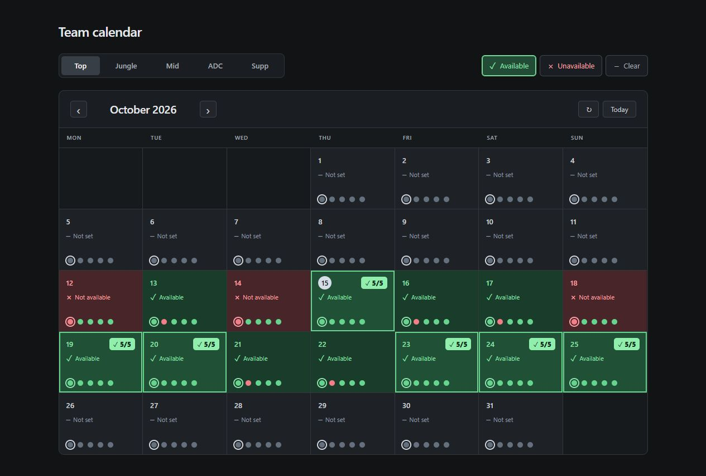

# Team Calendar

A simple availability calendar for a five-player League of Legends team. Choose your role, mark your days, and see when everyone can play.

**React · JSX · Vite · Netlify Functions & Blobs**



## Features

- Top, Jungle, Mid, ADC, and Supp roles.
- Click or drag to mark days available, unavailable, or clear.
- Team status dots and highlighted **5/5** days.
- dark UI with shared, persistent availability.
- Batched saves and cached month data to reduce hosting usage. Press **↻** to fetch the latest changes.

## Run locally

Requires Node.js and npm. Tested with Node.js 24.

```sh
npm ci
npm run dev
```

Open **http://localhost:5173**. Local data is saved to `data/availability.json` and excluded from Git.

Run `npm test` for tests or `npm run build` for a production build.